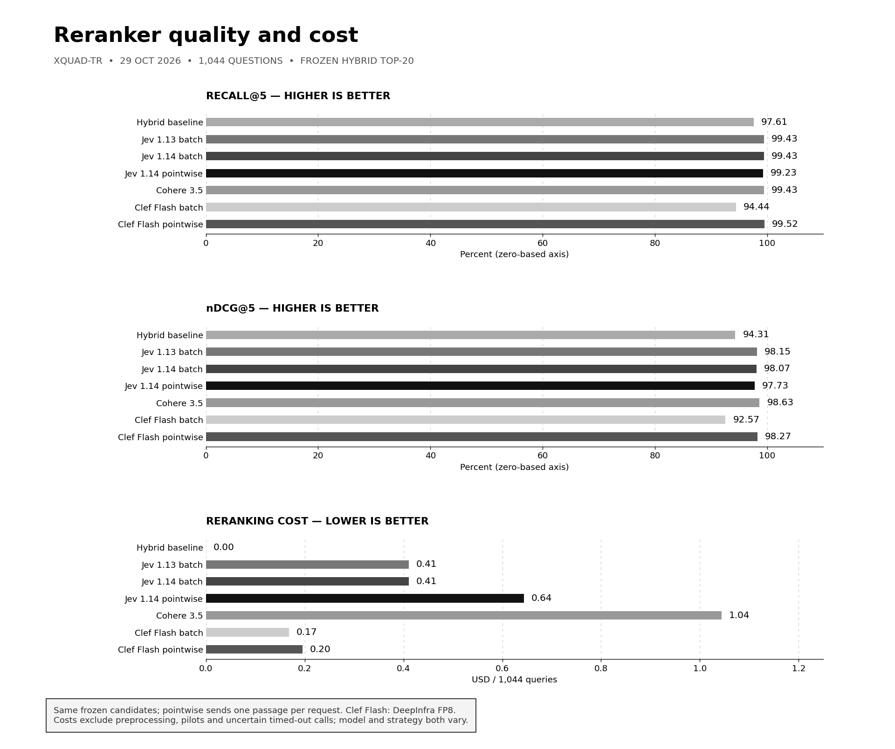
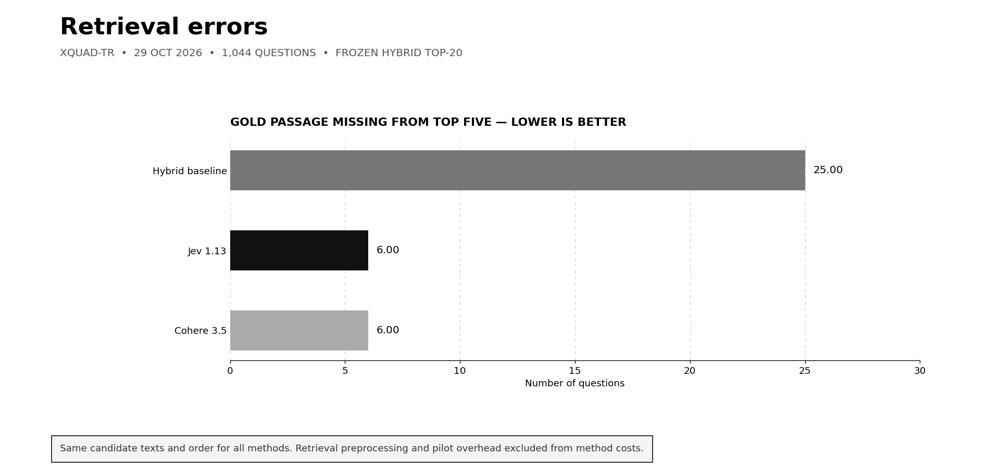
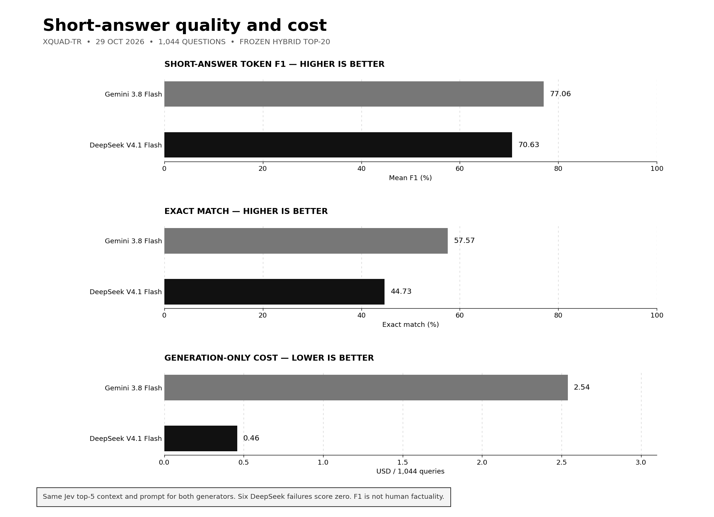

# jev-rag-benchmark

A small, auditable Turkish RAG experiment: does reranking improve passage selection,
and how do two answer models perform on identical retrieved evidence?

**Current evaluation: 29 October 2026 — 1,044 XQuAD-TR test questions, 240 passages.**
This is a short-answer benchmark on a small corpus, not a general-purpose RAG leaderboard.

## What is held constant?

- The candidate pool is the historical hybrid BM25 + BGE-M3 baseline's top 20, frozen once.
- Jev, Cohere and Clef Flash receive identical candidate **texts and order** for every question.
- All rerankers return five passages. The baseline retains the original hybrid order.
- Gemini and DeepSeek receive the **same Jev top-five context and exact prompt**, capped at
  6,000 context characters. They must return a short answer span with a source citation.
- Both use temperature 0, seed 20260919, medium reasoning and a 4,096 output-token limit.
- Generation errors and truncated outputs receive zero EM/F1; they are not dropped.

The published run contains 1,044 unique, matched questions and **zero candidate mismatches**.
The corpus SHA-256 matches the historical corpus. The frozen pool, per-question outputs,
prompt hashes and model identities are committed under [`results/fair-2026-10-29/`](results/fair-2026-10-29/).

## Passage selection

Generation is excluded from this comparison. All metrics use the final **five** passages.

| Method | Recall@5 ↑ | Gold in top-5 | nDCG@5 ↑ | MRR@5 ↑ | Reranking cost |
|---|---:|---:|---:|---:|---:|
| Hybrid baseline | 97.605% | 1,019 / 1,044 | 94.314% | 93.194% | $0 API reranking |
| Jev 1.13 | **99.425%** | **1,038 / 1,044** | 98.151% | 97.712% | $0.410866 |
| Cohere Rerank 3.5 | **99.425%** | **1,038 / 1,044** | **98.626%** | **98.348%** | $1.044000 |
| Clef Flash (DeepInfra FP8) | 94.444% | 986 / 1,044 | 92.567% | 91.935% | **$0.168440** |

Jev and Cohere achieve the same aggregate top-five recall. Cohere has slightly higher
ranking scores; Jev costs 60.6% less for reranking. Jev yields 19 additional top-five hits
relative to the hybrid baseline. Equal hit counts do not imply identical retrieved sets.
These are observations on this dataset, not universal superiority claims.






### Clef Flash extension

Clef Flash was evaluated on the same frozen 1,044 questions, with exactly the Jev batch
state and relevance questions, selecting five passages by descending probability and
breaking ties by original candidate order. OpenRouter routing was pinned to **DeepInfra
(FP8)** with provider fallbacks disabled. This is a provider-specific result, not a claim
about every Clef Flash deployment.

Clef Flash achieved **94.444% Recall@5** and **92.567% nDCG@5**,
below both Jev and the hybrid baseline. Its retained-run cost was **$0.168440**,
59.0% below Jev, at the observed $0.019/million input-token rate.
Its lower cost came with worse retrieval quality on this protocol; it is not the recommended
replacement for Jev on this dataset. No answer generation was rerun for Clef Flash.

A longest-character-input preflight correctly read a sentinel at the end of the state;
this is a truncation smoke check, not exhaustive proof that every passage was attended to.
All measured requests stayed below the provider's 24,576-token window
(maximum observed: 10,815). Ten pilot queries passed technical checks and were
retained in the full run. All 1,044 requests completed without errors or retries.
The extension cost **$0.168647 including preflight**, under its separate $0.60 cap.
The original $6 run accounting below is unchanged.

[Raw Clef Flash responses and provenance](results/clef-flash-2026-10-29/) include all
20 candidate probabilities, provider-reported usage, request hashes and paired hit counts.
The dry-run command below makes no API calls; adding `--run` starts paid calls:

```bash
uv run python scripts/run_clef_flash.py
```

## Short-answer generation on identical Jev contexts

Citations are removed before text scoring. Token F1 measures word overlap with extractive
references; exact match measures normalized text equality. Neither is a human factuality score.

| Metric | Gemini 3.8 Flash | DeepSeek V4.1 Flash |
|---|---:|---:|
| Questions, including failures | 1,044 | 1,044 |
| Mean token F1 | **77.058%** | 70.634% |
| Exact match | **57.567%** | 44.732% |
| F1 ≥ 0.5 rate (lexical threshold) | **83.716%** | 78.927% |
| Empty/truncated responses | **0** | 6 |
| Generation-only cost | $2.539025 | **$0.459019** |
| Jev + generation cost | $2.949891 | **$0.869884** |

Gemini's paired mean-F1 advantage is **6.424 percentage points**; the question-level paired
bootstrap 95% interval is **4.806–7.987 points** (2,000 resamples, seed 20261029).
Questions sharing passages are not independent; this interval does not model passage/article
clustering, repeated runs or provider variability. DeepSeek has lower observed API cost.
The six failed DeepSeek responses are included with zero scores, not silently retried away.



Observed generation medians were 3.641 s (Gemini) and 1.676 s (DeepSeek), but **this is not a
controlled speed ranking**: concurrency changed from four to sixteen during the run.
Provider routes and time of measurement can also affect latency.

## Budget and operational record

The approved cap was $6. Recorded API charges across pilots, partial attempts and the full
run were **$4.552380**. An additional **$0.50 uncertainty reserve** was retained for interrupted
in-flight requests: conservative budget accounting was **$5.052380**, below the cap.
This is telemetry-based accounting, not a reconciled invoice. Method costs above describe
retained full-run observations and exclude pilot/restart overhead and the uncertainty reserve.

The first generation pilot rejected disabled reasoning. The successful pilot and full run
used medium reasoning. Execution was restarted to increase concurrency and later after an
empty generation. Completed observations were retained; incomplete queries were rerun.
After the error-policy correction, empty/truncated outputs were retained as failures.
No retries were selected on answer F1. These operational changes limit claims of a perfectly
preregistered experiment; a clean repeated run is a useful future validation.

No new embedding calls were needed: this run reused the frozen historical candidate pool.
Offline pool construction is excluded from reported online costs and timings.

## Audit and regenerate — no API calls

Requirements: Python 3.12 and [uv](https://docs.astral.sh/uv/).

```bash
uv sync --frozen --extra dev
uv run pytest
uv run ruff check .
uv run --with matplotlib==3.10.8 python scripts/publish_results.py
```

The publishing script validates coverage, candidate order, prompt reconstruction and answer
scores against the frozen artifacts before regenerating all six SVG/PNG figures. The figures
retain the monochrome presentation and use zero-based axes. Raw observations are available in
[`results.jsonl`](results/fair-2026-10-29/results.jsonl); aggregate values and provenance are in
[`summary.json`](results/fair-2026-10-29/summary.json) and
[`manifest.json`](results/fair-2026-10-29/manifest.json).

## Running a new experiment

```bash
uv run jev-rag data prepare
# Free fixture smoke; does not measure actual model quality.
uv run jev-rag benchmark smoke --dataset scifact --branches A,D --fixture-jev --skip-generation
```

Paid runs require `OPENROUTER_API_KEY` and an explicit positive budget in a copied config;
never commit credentials. Default budget is zero. Review current provider pricing first.
`retrieval.frozen_pool_path` selects the immutable snapshot path. Use a different path for a
new dataset, sample or retrieval configuration. A mismatch fails instead of overwriting the
pool. Use the same path/config for all shards of one experiment.

`merge-results` and the report generator reject missing/incompatible protocol IDs, duplicate
observations, differing candidates and unequal branch coverage. Legacy result files cannot
be fed into the new reporting path. Replay rejects changed source/configuration on resume.
The general-purpose API clients have estimated-cost checks, not provider-side prepaid caps;
for strict spending limits also configure a provider key limit. The operational $6 run used
an additional shared reservation gate and conservative reserve.

## Historical results and corrections

The September 20 reports remain under `reports/generated/` and `docs/benchmark-2026-09-20.md`
for auditability and are explicitly marked **legacy**. They are not current leaderboard data.

1. Cohere candidate order differed on 124 questions, with different sets on 25. The old
   claim that all rerankers saw exactly the same candidates was incorrect.
2. Legacy `nDCG@10`/`MRR@10` were computed over only five returned contexts. Their proper
   interpretation is truncated-at-five scoring, not a full top-ten ranking evaluation.
3. Sentence-form answers were compared with short extractive references. For example,
   “Panthers savunması ligde sadece 308 sayı bırakmıştır” scored F1 0.25 against `308` despite
   answering the question. Legacy “wrong answer” and “cost per successful answer” claims
   must not be interpreted as factual correctness or used for model recommendations.
4. The old DeepSeek quality recommendation is superseded. Under the new short-answer
   protocol Gemini has higher lexical quality; DeepSeek has lower generation cost.
5. Older strategy ablations and self-verification claims were not rerun. They are excluded
   from current recommendations, rather than combined with the new full-run scores.

Old and new F1 values must not be read as model improvement over time: the protocol changed
and provider/model execution was repeated. The new results establish a comparison only
within this fixed dataset, prompt and model configuration.

## Scope and licenses

XQuAD-TR is primarily extractive QA with one annotated gold passage per question and only
240 corpus passages. Results do not establish robustness on large enterprise corpora,
unanswerable questions, adversarial documents, conversational tasks or other languages.
Citation IDs alone do not prove source support. Human-reviewed factuality evaluation and
article-level uncertainty estimates remain future work.

Source code: MIT. XQuAD: CC BY-SA 4.0; frozen corpus excerpts retain that license and originate
from [Google DeepMind XQuAD](https://github.com/google-deepmind/xquad). SciFact annotations:
CC BY 4.0; abstracts: ODC-By 1.0. Upstream code attribution is in [`NOTICE`](NOTICE).
